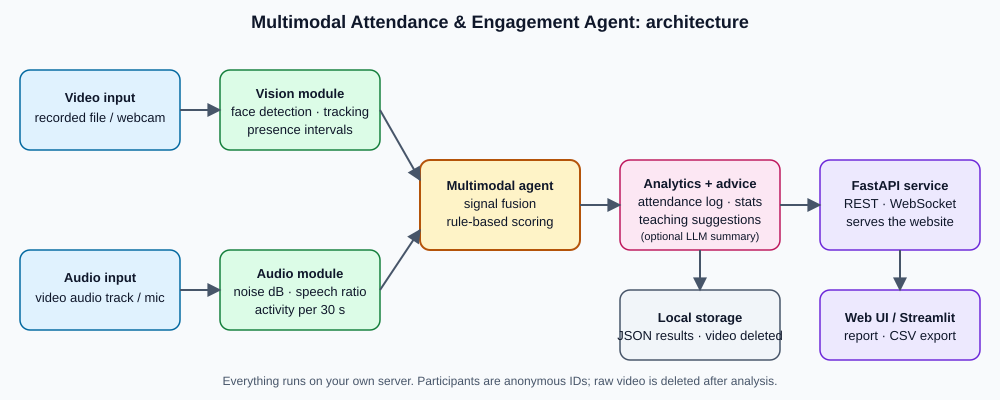

# Classroom Pulse: Multimodal Attendance & Engagement Agent

AI-powered, privacy-preserving classroom intelligence. It processes classroom video and audio to **mark attendance from sustained presence**, **analyse engagement over time**, and **suggest teaching adjustments**. Participants are anonymous IDs, there is no face recognition, uploaded video is deleted after analysis, and everything runs on your own server.

**Links:** GitHub: `ADD-REPO-URL` · Live demo: `ADD-DEMO-URL` · Demo video: `ADD-VIDEO-URL`

## Features by scenario
1. **Automated attendance.** Haar-cascade face detection with centroid tracking. A person counts as present only if seen for at least N seconds (default 10) and for one continuous stretch of N/2. Timestamped presence intervals per participant, with CSV export.
2. **Engagement dynamics.** Per 30 s window: attention (frontal vs profile face, a head-orientation proxy), movement, stillness duration and audio speech activity are fused into a score with High/Medium/Low levels. Weights and thresholds are in `backend/core/multimodal_agent.py`.
3. **Teaching suggestions.** Rule-based agent flags attention drops, long silent stretches, a fading second half, late arrivals, learners facing away and long stillness. An optional LLM (Groq) adds a short narrative from aggregate numbers only.

## Architecture

| Module | File |
|---|---|
| Video/camera input | `core/camera_service.py`, `pipeline.py` |
| Face detection, tracking, presence | `core/face_detection.py`, `core/tracker.py` |
| Audio analysis | `core/audio_analysis.py` |
| Fusion and scoring | `core/multimodal_agent.py` |
| Student analytics, suggestions | `core/analytics.py`, `core/ai_suggestions.py` |
| API (REST + WebSocket) and website | `main.py`, `static/index.html` |
| Optional Streamlit dashboard | `dashboard/dashboard.py` |

## Run locally
    python -m venv venv && venv\Scripts\activate        # Mac/Linux: source venv/bin/activate
    pip install -r backend/requirements.txt             # install ffmpeg for audio from video files
    cd backend && uvicorn main:app --reload --port 8000  # open http://localhost:8000
Optional dashboard: `streamlit run dashboard/dashboard.py`. Docker: `docker compose up --build`.

## Deploy
- **Render:** New Web Service from the repo (`render.yaml` included).
- Optional env var `GROQ_API_KEY` (and `GROQ_MODEL`). Without it the system is fully offline.

## API
`POST /api/analyze` (video, min_presence) · `POST /api/webcam` · `GET /api/jobs/{id}` · `GET /api/export/{id}.csv` · `WS /ws/audio` · `GET /docs`

## Testing and results
    pytest tests                                         # unit/smoke tests
    python tests/evaluate.py clip.mp4 --truth 4          # accuracy + speed, appends to tests/results.md

Paste your table here:

| clip | length | actual present | system present | error | processing | speed vs realtime | avg engagement |
|---|---|---|---|---|---|---|---|
| _run tests/evaluate.py_ | | | | | | | |

## Privacy
Anonymous IDs only; no biometric templates; video deleted after analysis; results stored locally as JSON; the cloud LLM is opt-in and receives only aggregate numbers.

## Limitations
- Head pose is a frontal/profile proxy, not full yaw/pitch estimation.
- The same person can receive a new ID after leaving view for more than 10 s.
- Haar cascades struggle with side angles, small faces and low light; a front-of-room camera works best.
- Engagement is a behavioural estimate and a decision-support signal, not a judgement of any individual.
- Job state is in memory; results are lost if a free host restarts.
